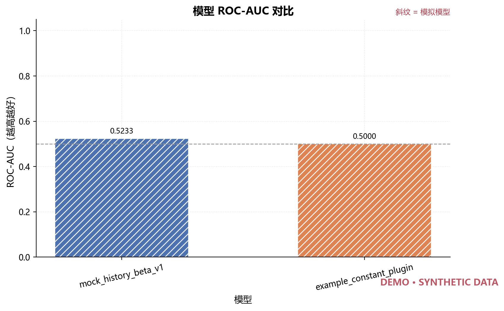
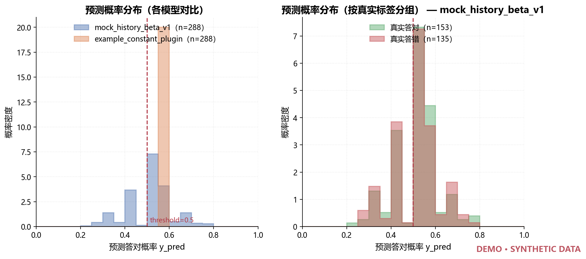
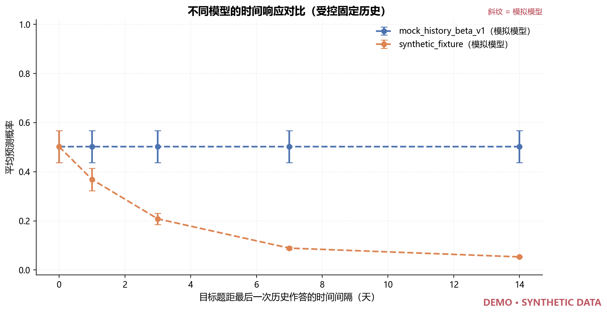
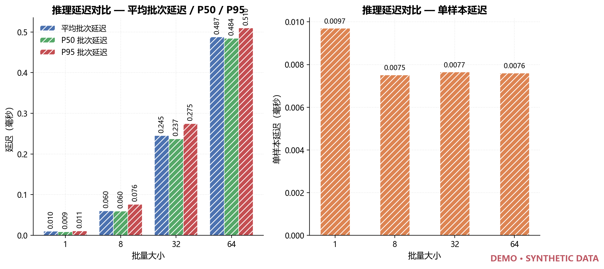

# 鸿蒙智学 · 知识追踪模型评估模块

面向知识追踪（Knowledge Tracing）模型的**评估与验证工具链**：给定一份符合约定格式的
预测结果 CSV，直接算出评价指标、生成实验图表并导出中文测试报告。

```bash
python evaluate.py all --overwrite     # 一条命令跑完全部评估流程
```

| 项目 | 实测结果 |
| --- | --- |
| 自动化测试 | **286 项通过 / 0 失败**（`python -m pytest -q`） |
| 静态检查 | **通过**（`python -m ruff check .`） |
| 集成验收 | **18 项全部通过**（`python scripts/acceptance_evaluation.py`） |
| 生成图表 | **9 张** PNG，DPI 200 |

> **⚠️ 数据真实性声明**
>
> 训练组已交付真实模型权重（`kt-forgetting` 仓库 74 份 `model.pt`），本项目已通过
> [`examples/kt_forgetting_plugin.py`](examples/kt_forgetting_plugin.py) 接入跑通，
> 产物标记 `is_mock=False`、`experiment_status=external_model_inference`。
>
> 但仓库内 `evidence/` 下的验收证据仍由 **合成数据 + 模拟模型** 生成（`is_mock=True`），
> 只能证明**评估程序本身正确**。真实精度、遗忘机制有效性与鸿蒙端侧性能
> 仍**没有**在有意义的 held-out 数据上验证过——仓库内 `data/` 为空，缺少真实作答 CSV。
>
> 程序对需要真实模型或真实数据才能完成的实验一律明确标注「**待真实模型接入**」或「未执行」，
> 不会生成虚假的实验结论。详见 [已验证 / 未验证范围](#已验证--未验证范围)。

---

## 目录

- [这是什么](#这是什么)
- [快速开始](#快速开始)
- [效果展示](#效果展示)
- [六个评估模块](#六个评估模块)
- [命令行接口](#命令行接口)
- [输入与输出格式](#输入与输出格式)
- [自动化测试与验收](#自动化测试与验收)
- [已验证 / 未验证范围](#已验证--未验证范围)
- [接入真实模型](#接入真实模型)
- [kt-forgetting 接入现状](#训练仓库-kt-forgetting-的接入现状)
- [目录结构](#目录结构)
- [文档索引](#文档索引)

---

## 这是什么

知识追踪模型输出的是「学生下一题答对的概率」。要判断一个模型好不好，光看损失曲线不够，
需要一套**口径统一、可复现、不编造**的评估流程。本模块提供这条流程：

| 模块 | 代码 | 解决什么问题 |
| --- | --- | --- |
| 模型评价指标 | [`evaluation/evaluator.py`](evaluation/evaluator.py) | AUC / Accuracy / Log Loss / Brier，支持阈值与冷启动分组 |
| 遗忘机制专项测试 | [`evaluation/forgetting_test.py`](evaluation/forgetting_test.py) | 模型对时间间隔是否有响应？两种互不替代的测试 |
| 模型对比测试 | [`evaluation/model_compare.py`](evaluation/model_compare.py) | 多模型按 `record_id` 严格对齐后比较，样本不一致直接报错 |
| 推理性能测试 | [`evaluation/performance_test.py`](evaluation/performance_test.py) | 批次/单样本延迟、P50/P95、吞吐量、多 batch size 对比 |
| 实验结果可视化 | [`evaluation/visualizer.py`](evaluation/visualizer.py) | 9 类图表，模拟数据自动加 DEMO 水印 |
| 测试报告生成 | [`evaluation/report_generator.py`](evaluation/report_generator.py) | 14 章节中文 Markdown 报告，数值全部来自实际产物 |

**设计原则**：宁可明确报错，也不静默丢弃样本；宁可标注「不可计算」，也不填占位数值。

---

## 快速开始

### 环境要求

- **Python ≥ 3.12**（与 `pyproject.toml` 一致；本次在 Python 3.11.9 上实机验证，代码未使用 3.12 专有语法）
- 依赖：`pandas`、`numpy`、`pytest`、`scikit-learn`、`matplotlib`

### 安装

```bash
git clone <本仓库地址>
cd knowledge_tracing_test

# 方式一：先装框架依赖，再装评估模块依赖
python -m pip install -r requirements-lock.txt
python -m pip install -r requirements-lock-evaluation.txt

# 方式二：只按版本范围安装
python -m pip install -r requirements.txt
```

macOS / Linux 也可以直接跑一键脚本（会创建 `.venv`）：

```bash
bash scripts/setup.sh && source .venv/bin/activate
python -m pip install -r requirements-lock-evaluation.txt
```

### 跑一遍

```bash
# 1. 先让框架产出预测结果（模拟模型 + 合成数据）
python main.py

# 2. 跑完整评估流程：指标 → 遗忘 → 对比 → 性能 → 图表 → 报告
python evaluate.py all --overwrite
```

结果在 `outputs/evaluation/`：

```text
outputs/evaluation/
├── metrics/        # metrics.csv / metrics.json      模型评价指标
├── forgetting/     # 时间分桶与受控时间响应结果
├── comparison/     # model_comparison.csv/.json/.md  多模型对比
├── performance/    # performance.csv/.json           推理延迟与吞吐量
├── plots/          # 9 张 PNG + plots_manifest.json
├── reports/        # evaluation_report.md            Markdown 报告
└── evaluation_summary.json                            本次运行的步骤与实际复现命令
```

打开 `outputs/evaluation/reports/evaluation_report.md` 即可看到完整报告。

---

## 效果展示

以下图表由 `python evaluate.py all` 实际生成，数据来自合成数据与模拟模型，
因此每张图都带 `DEMO · SYNTHETIC DATA` 水印。

### 模型指标对比



### 预测概率分布

左图叠加各模型的 `y_pred` 分布并标出分类阈值；右图按真实标签分组——
两组分布重叠越多，说明模型区分能力越弱。图中可见常量插件在 0.6 处单峰、
两组标签分布高度重叠，与其 AUC ≈ 0.5 的结论一致。



### 时间响应对比（受控固定历史）

同一个学生的历史学习状态、目标题目与知识点完全固定，只改变目标时点与最后一次
历史作答的时间间隔（0/1/3/7/14 天）：

- `mock_history_beta_v1`：**平线** —— 负责人 A 的 Mock 模型没有遗忘机制，
  概率不随时间变化是**正确结果**（最大变化 0.0）；
- `synthetic_time_sensitive_fixture_v1`：**单调下降** —— 一个明确标注的合成夹具，
  仅用于证明「本测试程序确实能发现时间响应」（Spearman = −1.0000）。



### 推理延迟



其余图表见 [`evidence/evaluation/plots/`](evidence/evaluation/plots/)：
ROC 曲线、Accuracy / Log Loss 对比、观察性时间响应曲线、吞吐量曲线。

---

## 六个评估模块

### 1. 模型评价指标

```bash
python evaluate.py metrics --predictions evidence/mock_run evidence/plugin_run
python evaluate.py metrics --predictions evidence/mock_run --threshold 0.4 --exclude-cold-start
```

输出 AUC / Accuracy / Log Loss / Brier，并按 `cold_start` 拆成
`all` / `non_cold_start` / `cold_start` 三个分组。

- **口径**：AUC 与 Log Loss 一律使用 `y_pred`（答对概率），**不使用** `predicted_label`；
  `y_pred` 是「答对概率」而不是「知识掌握概率」，报告中严格区分。
- **单类别**：测试集只有正样本或只有负样本时，AUC **明确标记为不可计算并给出原因**，
  绝不返回 0.5 或 1.0 之类的占位值。
- **正确性**：对标准数据 `y_true=[0,0,1,1]`、`y_pred=[0.1,0.4,0.35,0.8]` 手算得
  AUC=0.75、Accuracy=0.75、LogLoss=0.4722879538，与程序输出一致到 1e-12；
  验收脚本另用**完全独立的实现**（Mann-Whitney 秩和定义算 AUC）复核真实数据，一致到 1e-9。

详细选型理由与公式推导见 [`docs/EVALUATION_METRICS.md`](docs/EVALUATION_METRICS.md)。

### 2. 遗忘机制专项测试

提供**两种性质完全不同、不可互相替代**的测试：

| | A. 描述性分析 | B. 受控时间测试 |
| --- | --- | --- |
| 输入 | 已有的 `predictions.csv` | 原始数据 + 模型 |
| 做法 | 按 `delta_time_seconds` 分桶统计 | 固定历史，只改目标时点 |
| 结论强度 | **观察性**，不能作为因果证据 | 检验模型是否对时间**响应** |
| 输出 | `interval_buckets.csv` | `controlled_time_response.csv` |

受控测试的关键设计：同一候选样本的 `history` 元组与目标题目完全不变，只把目标时点改为
`最后一次历史答案可见时点 + interval`，**因果顺序始终成立**（目标时点永不早于任何历史答案）。

```bash
# A 部分
python evaluate.py forgetting --predictions evidence/mock_run

# A + B
python evaluate.py forgetting --predictions evidence/mock_run --input sample_data.csv \
    --intervals 0,1,3,7,14 --unit days --repeats 3 --max-requests 24

# 加入第二个模型以生成对比图
python evaluate.py forgetting --input sample_data.csv \
    --controlled-model fixture=evaluation.synthetic_time_model:create_model
```

仅有 `event_order`（没有真实时间）的数据会被**整体排除并说明原因**，不会把事件顺序
伪造成天数。

### 3. 模型对比测试

```bash
python evaluate.py compare --predictions evidence/mock_run evidence/plugin_run \
    --labels baseline dkt_forgetting --baseline baseline
```

**默认严格对齐**，以下情况直接失败而不是静默丢样本：

- 各模型 `record_id` 集合不一致 → 列出各模型样本数与差异数后失败
- 同一 `record_id` 的 `y_true` 冲突 → 列出冲突样本后失败
- 同一 `record_id` 的 `student_id` / `question_id` / `skill_id` 不一致 → 失败

确实需要取交集时必须显式声明 `--missing-policy intersect`，此时被丢弃的样本数、
涉及模型与具体 `record_id` 都会写入产物并在报告中警告。

### 4. 推理性能测试

```bash
python evaluate.py performance --input sample_data.csv \
    --batch-sizes 1,8,32,64 --repeats 3 --warmup 1 --max-requests 256
```

计时口径（已写入报告）：

- **批次延迟** = 单次 `adapter.predict(batch)` 的墙钟耗时（`time.perf_counter`）
- **单样本延迟** = 批次延迟 ÷ 该批次样本数
- **P50 / P95** = 对批次延迟序列取 `numpy.percentile` 线性插值
- **吞吐量** = 被计时样本总数 ÷ 被计时总耗时

只使用能整除的**完整批次**，且所有 batch size 共用**同一请求池**，保证数字可比。

### 5. 实验结果可视化

9 类图表全部由 `matplotlib` 生成，不写死任何数值：

| 图表 | 文件 |
| --- | --- |
| AUC / Accuracy / Log Loss 对比柱状图 | `auc_comparison.png` 等 3 张 |
| ROC 曲线 | `roc_curves.png` |
| **预测分布图** | `prediction_distribution.png` |
| 遗忘时间响应曲线（观察性） | `forgetting_observed.png` |
| 不同模型的时间响应对比 | `forgetting_model_compare.png` |
| 推理延迟对比 | `inference_latency.png` |
| 不同 batch size 吞吐量 | `throughput_by_batch.png` |

- 无法计算的指标（如单一类别的 ROC）**跳过并在 `plots_manifest.json` 写明原因**，不画空图。
- 数据来自 `is_mock=True` 的模型时，图中自动加 `DEMO · SYNTHETIC DATA` 水印，并用斜纹柱区分。
- 优先使用中文字体；环境缺少中文字体时自动回退英文标签，不会画出方框。

### 6. 测试报告生成

```bash
python evaluate.py report --evaluation-dir outputs/evaluation \
    --docs-report docs/EVALUATION_TEST_REPORT.md --overwrite
```

自动生成 14 章节中文 Markdown 报告，所有数值与图片链接都由程序从上述产物读取：

概述 → 环境版本 → 数据来源与性质 → 模型与配置 → 评价指标 → 遗忘测试 → 多模型对比 →
推理性能 → 图表 → 异常与边界测试 → 自动化测试结果 → **未完成的真实模型验证事项** →
复现命令 → 真实模型接入说明

未获得真实模型的项目一律标注 **待真实模型接入**，无数据章节写「未执行」并说明原因。

---

## 命令行接口

统一入口 `evaluate.py`，7 个子命令，退出码与 `main.py` 一致（成功 `0`，错误 `2`）：

| 命令 | 作用 |
| --- | --- |
| `metrics` | 计算 ROC-AUC / Accuracy / Log Loss / Brier，支持冷启动分组 |
| `forgetting` | 遗忘机制专项测试（描述性 + 受控固定历史） |
| `compare` | 多模型按 `record_id` 严格对齐比较 |
| `performance` | 推理延迟、P50/P95、吞吐量 |
| `plots` | 生成全部可计算的图表 |
| `report` | 生成 Markdown 报告 |
| `all` | 按当前可用输入完成全部流程 |

```bash
python evaluate.py --help
python evaluate.py metrics --help          # 每个子命令都有独立帮助
```

常用通用参数：`--output-dir`（输出目录）、`--overwrite`（显式允许覆盖）、
`--seed`（随机种子）、`--threshold`（分类阈值）、`--exclude-cold-start`（排除冷启动）。

`all` 命令只跳过「输入不存在」的步骤并写明原因；真正的错误（数据损坏、样本无法对齐）
会立即以退出码 2 失败，**不会吞掉异常伪装成功**。

---

## 输入与输出格式

### 输入

预测结果 CSV（`predictions.csv`），也可以直接传**完整运行目录**（自动读取
`predictions.csv` 与 `run_summary.json`）。

必需列：

| 列 | 说明 |
| --- | --- |
| `record_id` | 唯一样本标识，非空、不可重复，是多模型对齐主键 |
| `y_true` | `0` / `1`，当前目标题的真实答题结果 |
| `y_pred` | `[0,1]` 有限实数，模型预测的**答对概率** |

可选列：`cold_start`、`delta_time_seconds`、`time_source`、`history_length`、
`model_name`、`is_mock`、`student_id`、`question_id`、`skill_id`。
缺失的可选列会使对应专项分析被**跳过并说明原因**，而不是给出错误结论。

校验规则（任何一项不通过都以退出码 2 结束，**不丢样本、不补默认值、不裁剪概率**）：
文件可解析 → 非空 → 必需列齐全 → `record_id` 非空且唯一 → `y_true ∈ {0,1}` →
`y_pred ∈ [0,1]` 有限 → `delta_time_seconds` 非负 → 布尔列与 `time_source` 取值合法。

完整规则见 [`docs/EVALUATION_INTERFACE.md`](docs/EVALUATION_INTERFACE.md)。

### 输出

| 目录 / 文件 | 内容 |
| --- | --- |
| `metrics/metrics.csv` `.json` | 每行一个「模型 × 样本分组」的指标 |
| `forgetting/interval_buckets.csv` | 时间间隔分桶统计 |
| `forgetting/controlled_time_response.csv` | 受控测试逐条观测 |
| `forgetting/forgetting_summary.json` | 相关系数、响应判定、口径说明 |
| `comparison/model_comparison.csv` `.json` `.md` | 对比结果与相对基准的差值 |
| `performance/performance.csv` `.json` | 延迟、吞吐量与环境信息 |
| `plots/*.png` + `plots_manifest.json` | 图表与生成/跳过清单 |
| `reports/evaluation_report.md` | 完整报告 |
| `evaluation_summary.json` | 本次运行的步骤与实际复现命令 |

---

## 自动化测试与验收

```bash
python -m pytest -q                      # 286 项通过
python -m ruff check .                   # 静态检查通过
python scripts/acceptance_evaluation.py  # 18 项集成验收
```

验收脚本实际执行以下检查，**核对退出码、结果内容与文件完整性**，而不是只判断文件是否存在：

1. 模型评价指标计算
2. AUC / Accuracy / Log Loss 数值校验（与独立手工计算对比，容差 1e-9）
3. 多模型对比测试
4. 遗忘时间描述性分析
5. 固定历史受控时间测试
6. Mock 模型推理性能测试
7. 可视化图表生成（9 张，校验 PNG 签名与分辨率）
8. 自动生成评估报告（校验章节完整性与图片链接有效性）
9. **8 项边界与异常检查**（缺列、非法标签/概率、重复 `record_id`、空文件、
   样本不一致、未接真实模型、非法时间间隔、仅有 `event_order` 的数据）
10. **验收标准**：单份预测 CSV 直接出指标 + 图表 + 报告
11. 原有 `main.py` 功能不受影响（校验退出码与 18 列定义）

结果写入 `evidence/evaluation/`，含 `acceptance.log`、`acceptance_summary.json`
（每项检查的期望、实际与产物 SHA256）、各模块结果、9 张图表与自动生成的报告。

---

## 已验证 / 未验证范围

### ✅ 已验证（合成数据 + 人工夹具，全部 `is_mock=True`）

- 指标计算正确性，含与独立手工计算的数值一致（1e-9）
- 单一类别时 AUC 明确标记为不可计算，不编造数值
- 冷启动样本可单独分组评估
- 严格输入校验：缺列、空文件、重复 `record_id`、非法标签、非法概率、负时间间隔全部失败
- 多模型严格对齐：样本覆盖不一致、标签冲突、元信息冲突全部失败，不静默删除样本
- 受控固定历史时间测试能正确区分「无遗忘机制的 Mock」与「合成时间敏感夹具」
- 仅有 `event_order` 的数据不会把事件顺序伪造成天数
- 9 张图表与 14 章节报告可自动生成，图片链接有效
- 原有 `main.py`、原有 93 项自动化测试与 `predictions.csv` 列定义未受影响

### ❌ 未验证（权重已到，缺真实 held-out 数据）

| 事项 | 需要的输入 |
| --- | --- |
| 真实 DKT/AKT 的预测精度 | 真实 held-out 作答 CSV（仓库 `data/` 为空） |
| 真实遗忘机制的有效性与遗忘曲线 | 同上；权重已交付，缺数据 |
| 真实模型与基线的对照结论 | 同上，且需同一测试集划分 |
| 真实模型推理性能与**鸿蒙端侧**性能 | 真实数据 + 端侧设备 |
| 真实数据上的知识点长尾表现 | 真实数据 |

> 用合成数据跑真实权重得到的指标**不能**当作精度结论：
> 夹具上的 AUC 只反映「模型没见过这份数据」，与模型好坏无关。

---

## 接入真实模型

评估程序**无需修改一行代码**即可评估真实模型，只要 `predictions.csv` 满足输入格式。

### 第 1 步：让训练组提供资产

1. 可导入的模型工厂 `create_model(config)` 与完整推理代码（`模块:函数`）
2. 模型权重 + 版本号 + SHA256 校验值 + 训练配置 + 目标设备要求
3. **与权重严格匹配的知识点词表 JSON**（`schema_version` / `unknown_id` / `skills`）
4. 题目词表与交互编码公式；多知识点聚合策略、未知标签策略、冷启动先验
5. 历史长度上限；是否需要真实时间及其单位；**遗忘机制参数的明确定义**
6. 一组固定输入的参考输出，用于核对接入后的数值一致性
7. **固定的训练/验证/测试划分**或可复现的划分脚本与随机种子

完整交接契约见 [`docs/MODEL_INTERFACE.md`](docs/MODEL_INTERFACE.md)。

### 第 2 步：生成真实模型预测

```bash
python main.py --model plugin --factory <模块>:create_model \
    --model-config model/config.json --vocab model/skill_mapping.json \
    --input data/heldout.csv --output-dir outputs/real_model
```

确认 `outputs/real_model/run_summary.json` 中 `"is_mock": false`。

### 第 3 步：用同一套评估程序评估

```bash
python evaluate.py all --run-dir outputs/real_model \
    --compare-runs outputs/baseline outputs/real_model --overwrite
```

`is_mock=False` 时报告会自动去掉模拟数据说明与图表水印，
第 12 节的「未完成事项」也会替换为真实结论。

### 训练仓库 kt-forgetting 的接入现状

训练仓库 `kt-forgetting`（知识图谱 + 知识追踪）已通过
[`examples/kt_forgetting_plugin.py`](examples/kt_forgetting_plugin.py) 接入，
**未修改该仓库任何一行代码，也未修改本项目的 `contracts.py`**。

首要澄清：**它输出的就是答对概率，不是知识掌握度**。证据在
`src/eval/predict_mastery.py:259` 的 `score_semantics: "predicted_response_probability"`
与 `:273` 打印的「预测答对概率，非真实掌握度」。因此 `y_pred` 可以直接接，指标口径无需改动。

主要差异与处理：

| 差异 | 处理 |
| --- | --- |
| 它是 CLI + 函数接口，本项目要可调用对象 | 适配器包一层 `predict(requests)` |
| 知识点用 `meta.json` 的密集 id | `skill_map`，或复用它的 `resolve_skill` |
| 历史每步要 `delta` **和** `dt_global` 两个数组 | 适配器从 `available_at` 推导，口径与它自己的 `load_history_json()` **逐项一致**（有测试固定） |
| 目标间隔语义 | `delta_time_seconds` 与它的 `gap_sec` 同义，直接映射 |

⚠️ **仅有 `event_order` 的数据无法驱动带遗忘机制的后端**：没有真实时间轴就推不出
`dt_global`。默认直接失败，不把事件顺序当秒数；确需无时间对照实验时才显式开启
`allow_order_only_time`。

**权重已随训练仓库交付**：`exp/<tag>/model.pt` 共 74 份、12.90 MB，已纳入版本控制。
`git pull` 即可加载真实模型，`is_mock=False`。已实测的情况：

| 后端 | 实测结果 |
| --- | --- |
| BKT | ✅ 真实 EM 拟合参数，`is_mock=False`，概率 0.284~0.766 |
| DKT + 遗忘机制 | ✅ 真实权重，`is_mock=False`；间隔 0→365 天概率 0.8565→0.8422（单调不增） |
| AKT + 遗忘机制 | ✅ 真实权重，`is_mock=False`；目录无 `meta.json`，词表大小从权重推断为 149 |
| MOOCCube 中文线代 DKT | ✅ 端到端跑通，22 个中文章节词表，`evaluate.py all` 六步无跳过 |

模块一的图谱是中文线性代数，而 ASSISTments（英文初中代数）与 EdNet（英语）题目域对不上。
训练仓库 v4 的 `*_mooccube_la_*` 系列在 **MOOCCube 中文线代子集**（清华 KEG + 学堂在线，
2,824 题 / 11.3 万条真实作答）上训练，是当前最贴合的选择，测试 AUC 0.780。

词表与适配器配置由脚本一次生成，避免「输入编码对上了、模型 id 却错位」：

```bash
python scripts/build_kt_forgetting_vocab.py \
  --meta ../kt-forgetting/exp/v4_mooccube_la_dkt_forget_s2026/meta.json \
  --out-dir examples --prefix kt_forgetting_mooccube
```

完整说明、配置字段、`is_mock` 规则与实测记录见
[**kt-forgetting 接入文档**](docs/KT_FORGETTING_INTEGRATION.md)。

---

## 目录结构

```text
knowledge_tracing_test/
├── evaluate.py                 # 刘静涵：评估模块统一入口（7 个子命令）
├── evaluation/                 # 刘静涵：六个评估模块
│   ├── common.py               #   共享校验与产物写出
│   ├── evaluator.py            #   ① 模型评价指标
│   ├── forgetting_test.py      #   ② 遗忘机制专项测试
│   ├── model_compare.py        #   ③ 模型对比测试
│   ├── performance_test.py     #   ④ 推理性能测试
│   ├── visualizer.py           #   ⑤ 实验结果可视化
│   ├── report_generator.py     #   ⑥ 测试报告生成
│   └── synthetic_time_model.py #   明确标注的合成时间敏感夹具（非真实模型）
│
├── main.py                     # 鲁凯宁：框架主程序
├── contracts.py                # 鲁凯宁：v1.0.0 接口契约
├── model_adapter.py            # 鲁凯宁：统一模型适配
├── mock_model.py               # 鲁凯宁：模拟模型
├── pipeline.py                 # 鲁凯宁：因果预测流水线
├── data_loader.py              # 鲁凯宁：数据读取与校验
├── io_utils.py                 # 鲁凯宁：原子写出与指纹
├── dataset_converters.py       # 鲁凯宁：ASSISTments / EdNet 转换器
│
├── tests/                      # 286 项自动化测试（含 kt-forgetting 适配 39 项）
├── docs/                       # 全部设计、接口、指标与交付文档
├── scripts/                    # 环境安装、验收、打包、kt-forgetting 词表生成
├── evidence/                   # 验收证据（含 evidence/evaluation/）
├── examples/                   # 插件示例、kt-forgetting 适配器与数据集夹具
├── data/                       # 自有数据目录
└── outputs/                    # 运行结果（不纳入版本控制）
```

---

## 文档索引

| 文档 | 内容 |
| --- | --- |
| [`docs/EVALUATION_METRICS.md`](docs/EVALUATION_METRICS.md) | **评价指标说明**：选型理由、公式、计算方法、局限 |
| [`docs/EVALUATION_INTERFACE.md`](docs/EVALUATION_INTERFACE.md) | **接口说明**：输入格式、校验规则、指标定义、对齐方法、输出格式 |
| [`docs/EVALUATION_GUIDE.md`](docs/EVALUATION_GUIDE.md) | **使用指南**：命令示例、结果解读、8 条口径陷阱、常见问题 |
| [`docs/EVALUATION_TEST_REPORT.md`](docs/EVALUATION_TEST_REPORT.md) | **实际评估报告**（由程序自动生成） |
| [`docs/EVALUATION_DELIVERY_CHECKLIST.md`](docs/EVALUATION_DELIVERY_CHECKLIST.md) | **交付核对表**：7 项任务对应成果与实际运行数值 |
| [`docs/DATA_FORMAT.md`](docs/DATA_FORMAT.md) | 框架输入/输出字段、缺失值、时间与词表规则 |
| [`docs/MODEL_INTERFACE.md`](docs/MODEL_INTERFACE.md) | 训练组接入契约 |
| [`docs/KT_FORGETTING_INTEGRATION.md`](docs/KT_FORGETTING_INTEGRATION.md) | **kt-forgetting 接入**：接口差异、时间轴推导、权重与词表现状、MOOCCube 模型选择、实测结果 |
