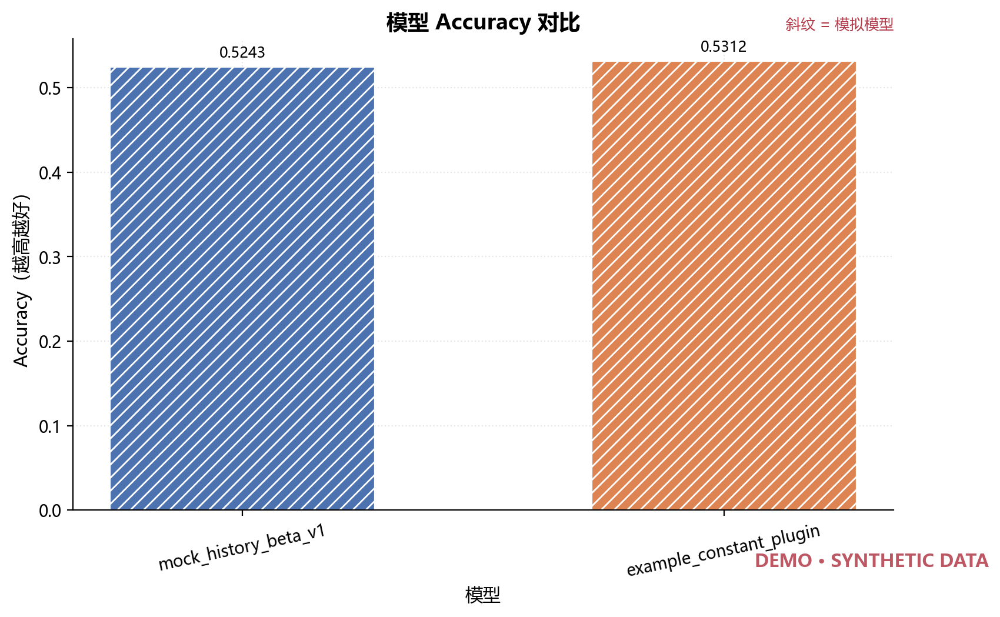
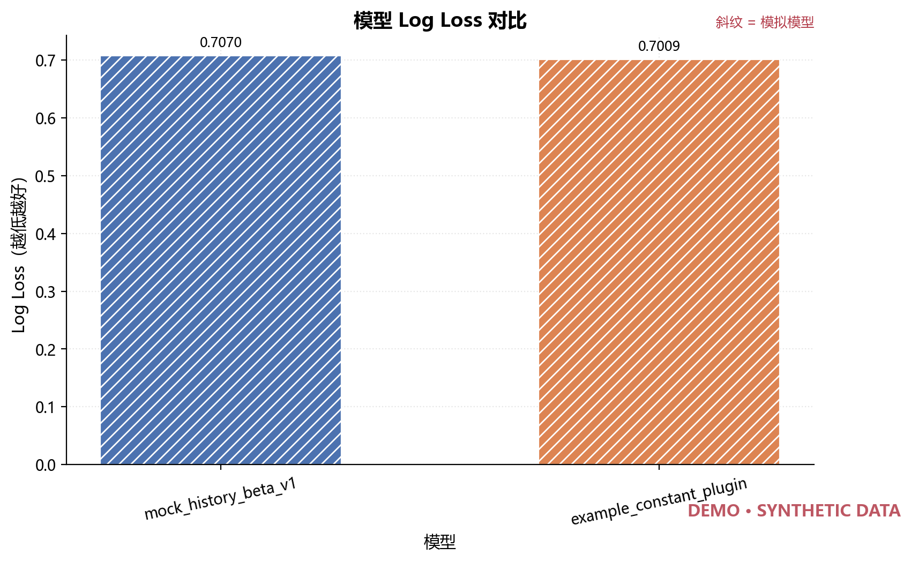
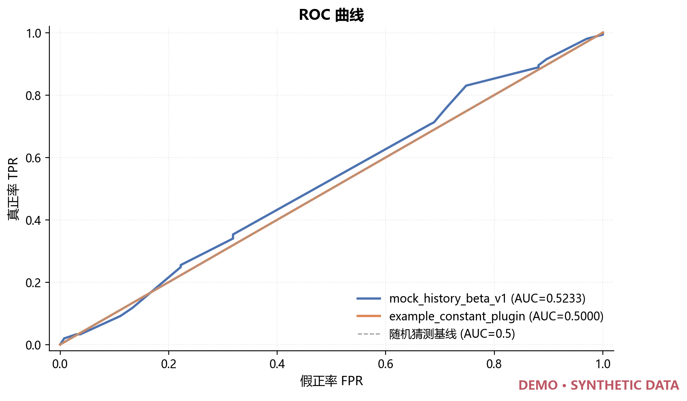
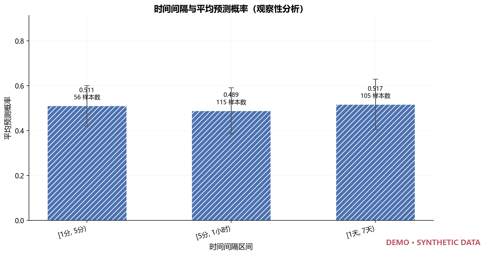
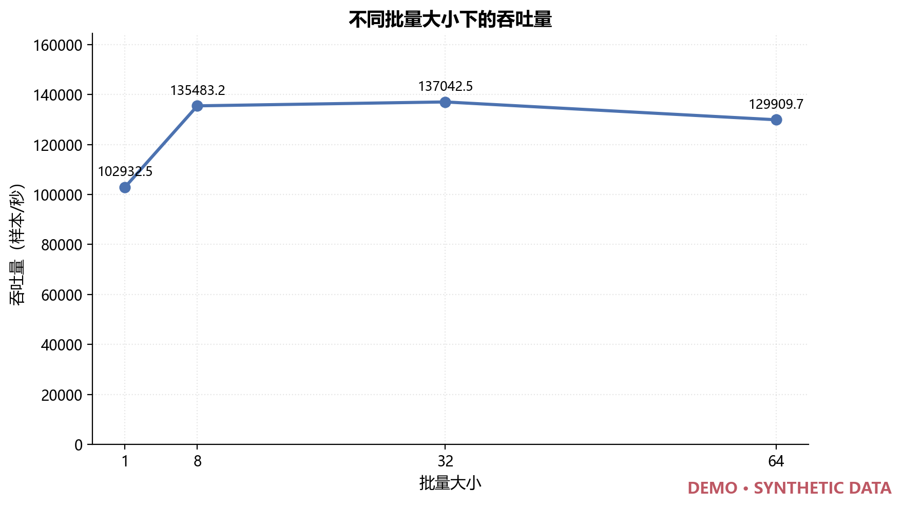

# 鸿蒙智学 · 知识追踪模型评估报告

评估模块版本 **1.0.0**，报告生成时间（UTC）**2026-10-17T05:58:41.001429+00:00**。本报告由 `evaluation/report_generator.py` 从实际运行产物自动生成，所有数值均可追溯到对应模块输出的 JSON / CSV 文件，没有人手工填入的实验数据。

## 1. 测试任务概述

本报告覆盖大创项目《基于知识图谱与认知诊断的个性化学习路径动态生成系统》（产品名「鸿蒙智学」）中负责人 B 刘静涵负责的模型评估工作，共六个模块：

| 模块 | 代码 | 说明 |
| --- | --- | --- |
| 模型评价指标 | `evaluation/evaluator.py` | ROC-AUC、Accuracy、Log Loss，支持阈值与冷启动分组 |
| 遗忘机制专项测试 | `evaluation/forgetting_test.py` | 描述性时间间隔分析与固定历史受控时间测试 |
| 模型对比测试 | `evaluation/model_compare.py` | 按 `record_id` 严格对齐的多模型指标对比 |
| 推理性能测试 | `evaluation/performance_test.py` | 批次/单样本延迟、P50/P95、吞吐量 |
| 实验结果可视化 | `evaluation/visualizer.py` | 八类图表的自动绘制 |
| 报告生成 | `evaluation/report_generator.py` | 本报告 |

评估程序不重新实现负责人 A 的测试框架，只消费 `predictions.csv` 与 `PredictionRequest` / `ModelAdapter` 接口。

## 2. 测试环境与版本

| 项目 | 值 |
| --- | --- |
| 操作系统 | Windows-10-10.0.26200-SP0 |
| Python | CPython 3.11.9 |
| CPU 逻辑核数 | 18 |
| 计时方式 | `time.perf_counter` |
| pandas | 2.2.3 |
| NumPy | 1.26.4 |
| scikit-learn | 1.6.1 |
| 评估模块版本 | 1.0.0 |

## 3. 数据来源及数据性质

| 标签 | 文件 | 模型 | is_mock | 样本数 | 正/负样本 | 时间来源 | 数据性质 |
| --- | --- | --- | :-: | ---: | ---: | --- | --- |
| mock_history_beta_v1 | `evidence/mock_run/predictions.csv` | `mock_history_beta_v1` | 是 | 288 | 153/135 | `timestamp` | 模拟模型输出（仅用于程序功能验证） |
| example_constant_plugin | `evidence/plugin_run/predictions.csv` | `example_constant_plugin` | 是 | 288 | 153/135 | `timestamp` | 模拟模型输出（仅用于程序功能验证） |

所有预测文件的 SHA256 与输入数据摘要见 `metrics/metrics.json` 的 `inputs` 字段。


## 4. 模型与运行配置

| 配置项 | 值 |
| --- | --- |
| 分类阈值 threshold | 0.5 |
| 是否包含冷启动样本 | 是 |
| 指标来源 | scikit-learn |
| 性能测试 batch sizes | [1, 8, 32, 64] |
| 性能测试重复轮数 / 预热批次数 | 3 / 1 |
| 请求池规模 | 256 |


## 5. 模型评价指标

指标口径：ROC-AUC 与 Log Loss 使用 `y_pred`（答对概率），绝不使用 `predicted_label`；Accuracy 使用 `y_pred >= threshold` 得到的分类标签。

| 模型 | 样本分组 | 样本数 | 正/负 | ROC-AUC | AUC 状态 | Accuracy | Log Loss | Brier |
| --- | --- | ---: | ---: | ---: | --- | ---: | ---: | ---: |
| mock_history_beta_v1 | all | 288 | 153/135 | 0.5233 | computed | 0.5243 | 0.7070 | 0.2564 |
| mock_history_beta_v1 | non_cold_start | 276 | 148/128 | 0.5238 | computed | 0.5290 | 0.7077 | 0.2566 |
| mock_history_beta_v1 | cold_start | 12 | 5/7 | 0.5000 | computed | 0.4167 | 0.6931 | 0.2500 |
| example_constant_plugin | all | 288 | 153/135 | 0.5000 | computed | 0.5312 | 0.7009 | 0.2538 |
| example_constant_plugin | non_cold_start | 276 | 148/128 | 0.5000 | computed | 0.5362 | 0.6989 | 0.2528 |
| example_constant_plugin | cold_start | 12 | 5/7 | 0.5000 | computed | 0.4167 | 0.7473 | 0.2767 |

> 指标在给定预测文件上计算；is_mock=True 表示模拟模型输出，只能验证评估程序正确性，不能证明 DKT/AKT 的真实预测精度。


## 6. 遗忘机制专项测试

### A. 现有预测结果的描述性分析

- 有效样本：276 / 288（排除 12 条，缺少有效真实时间间隔（冷启动或仅有 event_order）；这些样本不参与时间分组）
- 时间来源：`timestamp`；分类阈值：0.5

| 时间间隔区间 | 样本数 | 占比 | 平均预测概率 | 中位预测概率 | 标准差 | 真实通过率 | 准确率 |
| --- | ---: | ---: | ---: | ---: | ---: | ---: | ---: |
| [1分, 5分) | 56 | 20.3% | 0.5110 | 0.5000 | 0.0903 | 0.4286 | 0.4643 |
| [5分, 1小时) | 115 | 41.7% | 0.4893 | 0.5000 | 0.1026 | 0.5652 | 0.5652 |
| [1天, 7天) | 105 | 38.0% | 0.5174 | 0.5000 | 0.1124 | 0.5619 | 0.5238 |

相关系数（观察性，仅供参考）：Pearson(delta, y_pred) = 0.0899，Spearman(delta, y_pred) = 0.0321，非冷启动样本 Spearman = 0.0321。

> 观察性分析：仅按已有预测结果的时间间隔分组统计，未控制学生、知识点、题目难度与历史长度，因此不能据此断言遗忘的因果效应。仅使用 event_order 的数据不含真实时间，已整体排除，未伪造天数。


### B. 固定学习历史的受控时间测试

#### 模型：`mock_history_beta_v1`

- 测试模型：`mock_history_beta_v1`（is_mock=True，模拟模型输出（仅用于程序功能验证））
- 输入数据：`sample_data.csv`，时间来源 `timestamp`，接受记录 288 条
- 候选样本：12 个；每个样本 5 个时间间隔 × 3 次重复；总推理次数 180
- 时间间隔（秒）：0, 86400, 259200, 604800, 1.2096e+06
- 检测到时间响应：**否**；相对基线的最大绝对变化 0；单调下降：否

| 时间间隔 | 候选样本数 | 观测数 | 平均预测概率 | 中位数 | 标准差 | 相对基线变化 | 重复间最大差异 |
| --- | ---: | ---: | ---: | ---: | ---: | ---: | ---: |
| 0秒 | 12 | 36 | 0.5017 | 0.5000 | 0.0652 | +0.0000 | 0 |
| 1天 | 12 | 36 | 0.5017 | 0.5000 | 0.0652 | +0.0000 | 0 |
| 3天 | 12 | 36 | 0.5017 | 0.5000 | 0.0652 | +0.0000 | 0 |
| 7天 | 12 | 36 | 0.5017 | 0.5000 | 0.0652 | +0.0000 | 0 |
| 14天 | 12 | 36 | 0.5017 | 0.5000 | 0.0652 | +0.0000 | 0 |

> 受控性说明：同一候选样本的历史学习状态、目标题目与知识点完全固定，仅改变目标时点与最后一次历史作答之间的时间间隔；目标时点始终不早于历史答案可见时点，因果顺序成立。该测试检验的是「模型是否对时间间隔作出响应」，不是「模型在真实数据上的遗忘效果」。

> 在 12 个候选样本、5 个时间间隔、3 次重复下，预测概率相对基线的最大变化为 0，未检测到时间响应。这是合理结果：负责人 A 的 MockModel 没有遗忘机制，本测试不得据此制造下降曲线。

> 模型声明 is_mock=True，本次结果只能证明受控测试程序可运行，不能证明任何遗忘机制的有效性。


#### 模型：`synthetic_fixture`

- 测试模型：`synthetic_time_sensitive_fixture_v1`（is_mock=True，模拟模型输出（仅用于程序功能验证））
- 输入数据：`sample_data.csv`，时间来源 `timestamp`，接受记录 288 条
- 候选样本：12 个；每个样本 5 个时间间隔 × 3 次重复；总推理次数 180
- 时间间隔（秒）：0, 86400, 259200, 604800, 1.2096e+06
- 检测到时间响应：**是**；相对基线的最大绝对变化 0.448；单调下降：是

| 时间间隔 | 候选样本数 | 观测数 | 平均预测概率 | 中位数 | 标准差 | 相对基线变化 | 重复间最大差异 |
| --- | ---: | ---: | ---: | ---: | ---: | ---: | ---: |
| 0秒 | 12 | 36 | 0.5017 | 0.5000 | 0.0652 | +0.0000 | 0 |
| 1天 | 12 | 36 | 0.3683 | 0.3671 | 0.0460 | -0.1334 | 0 |
| 3天 | 12 | 36 | 0.2081 | 0.2075 | 0.0228 | -0.2936 | 0 |
| 7天 | 12 | 36 | 0.0890 | 0.0888 | 0.0056 | -0.4127 | 0 |
| 14天 | 12 | 36 | 0.0534 | 0.0534 | 0.0005 | -0.4484 | 0 |

> 受控性说明：同一候选样本的历史学习状态、目标题目与知识点完全固定，仅改变目标时点与最后一次历史作答之间的时间间隔；目标时点始终不早于历史答案可见时点，因果顺序成立。该测试检验的是「模型是否对时间间隔作出响应」，不是「模型在真实数据上的遗忘效果」。

> 模型声明 is_mock=True，本次结果只能证明受控测试程序可运行，不能证明任何遗忘机制的有效性。


## 7. 多模型对比测试

## 多模型对比测试

- 基准模型：**mock_beta**；对齐样本数：288
- 对齐策略：`strict`；分类阈值：0.5；包含冷启动：是

| 样本分组 | 模型 | 模拟模型 | 样本数 | ROC-AUC | Accuracy | Log Loss | ΔAUC | ΔAccuracy | ΔLogLoss |
| --- | --- | :-: | ---: | ---: | ---: | ---: | ---: | ---: | ---: |
| all | mock_beta（基准） | 是 | 288 | 0.5233 | 0.5243 | 0.7070 | +0.0000 | +0.0000 | +0.0000 |
| all | constant_plugin | 是 | 288 | 0.5000 | 0.5312 | 0.7009 | -0.0233 | +0.0069 | -0.0062 |
| non_cold_start | mock_beta（基准） | 是 | 276 | 0.5238 | 0.5290 | 0.7077 | +0.0000 | +0.0000 | +0.0000 |
| non_cold_start | constant_plugin | 是 | 276 | 0.5000 | 0.5362 | 0.6989 | -0.0238 | +0.0072 | -0.0088 |
| cold_start | mock_beta（基准） | 是 | 12 | 0.5000 | 0.4167 | 0.6931 | +0.0000 | +0.0000 | +0.0000 |
| cold_start | constant_plugin | 是 | 12 | 0.5000 | 0.4167 | 0.7473 | +0.0000 | +0.0000 | +0.0542 |

### 对齐与核对说明

- 各模型覆盖完全相同的 288 个测试样本。

### 结论边界

> 对比结果只在给定的预测文件之间成立。is_mock=True 的模拟模型之间的差异不能证明任何新模型优于基线，也不能替代在真实 DKT/AKT 上的对照实验。
> 本次参与对比的 2 个模型全部为模拟模型（['mock_beta', 'constant_plugin']），结果不能证明任何模型优于基线。


## 8. 推理性能测试

- 测试模型：`mock_history_beta_v1`（is_mock=True，模拟模型输出（仅用于程序功能验证））
- 请求池：`sample_data.csv` 的 256 条请求；每个批量重复 3 轮，预热 1 个批次
- 运行环境：CPython 3.11.9，Windows-10-10.0.26200-SP0，CPU 逻辑核 18
- 计时方式：`time.perf_counter`

| 批量大小 | 批次数 | 样本数 | 平均批次延迟(ms) | P50(ms) | P95(ms) | 单样本平均(ms) | 吞吐量(样本/秒) |
| ---: | ---: | ---: | ---: | ---: | ---: | ---: | ---: |
| 1 | 768 | 768 | 0.010 | 0.009 | 0.011 | 0.010 | 102932.5 |
| 8 | 96 | 768 | 0.059 | 0.059 | 0.074 | 0.007 | 135483.2 |
| 32 | 24 | 768 | 0.234 | 0.233 | 0.249 | 0.007 | 137042.5 |
| 64 | 12 | 768 | 0.493 | 0.488 | 0.539 | 0.008 | 129909.7 |

> 计时口径：批次延迟为单次 adapter.predict(batch) 的墙钟耗时（time.perf_counter）；单样本延迟为批次延迟除以该批次样本数；P50/P95 对批次延迟序列取线性插值百分位；吞吐量为被计时样本数除以被计时的总耗时。

> 性能数字只代表本次运行所在机器的本次测量：它既不等同于 run_summary.json 中的流水线累计耗时 (model_seconds)，也不等同于鸿蒙端侧性能。模拟模型（is_mock=True）的性能不能代表真实 DKT/AKT 的推理开销。


## 9. 实验结果图表

本图使用 matplotlib 生成，DPI = 200，标签语言 `zh`。凡数据来自 `is_mock=True` 的模拟模型，图中均带 `DEMO · SYNTHETIC DATA` 水印。

### AUC 对比柱状图


数据来源：`metrics/metrics.json`；模拟数据水印：有

### Accuracy 对比柱状图



数据来源：`metrics/metrics.json`；模拟数据水印：有

### Log Loss 对比柱状图



数据来源：`metrics/metrics.json`；模拟数据水印：有

### ROC 曲线



数据来源：`metrics/metrics.json + predictions.csv`；模拟数据水印：有

### 预测分布图


数据来源：`predictions.csv`；模拟数据水印：有

### 遗忘时间响应曲线（观察性）



数据来源：`forgetting/interval_buckets.csv`；模拟数据水印：有

### 不同模型的时间响应对比图


数据来源：`forgetting/forgetting_summary.json`；模拟数据水印：有

### 推理延迟对比图


数据来源：`performance/performance.csv`；模拟数据水印：有

### 不同 batch size 下的吞吐量图



数据来源：`performance/performance.csv`；模拟数据水印：有


## 10. 异常情况与边界测试

以下结果来自实际执行 `scripts/acceptance_evaluation.py` 的摘要：共 **8** 项边界与异常检查，通过 **8** 项。

| # | 检查项 | 期望 | 实际 | 结果 |
| ---: | --- | --- | --- | :-: |
| 1 | 缺少必需列的预测文件报错 | 退出码 2 且不生成输出目录 | 退出码 2，无输出目录 | 通过 |
| 2 | 非法标签与非法概率报错 | 退出码 2 且不生成输出目录 | 退出码 2，无输出目录 | 通过 |
| 3 | 重复 record_id 报错 | 退出码 2 且不生成输出目录 | 退出码 2，无输出目录 | 通过 |
| 4 | 空预测文件报错 | 退出码 2 且不生成输出目录 | 退出码 2，无输出目录 | 通过 |
| 5 | 模型样本数不一致时严格失败 | 退出码 2 且不生成输出目录 | 退出码 2，无输出目录 | 通过 |
| 6 | 未接入真实模型时明确失败 | 退出码 2 且不生成输出目录 | 退出码 2，无输出目录 | 通过 |
| 7 | 非法的受控时间间隔报错 | 退出码 2 且不生成输出目录 | 退出码 2，无输出目录 | 通过 |
| 8 | 仅有 event_order 的数据不伪造时间 | 标记为不适用、不产出时间分桶、不影响退出码 | 退出码 0；原因「没有任何样本带有有效的真实时间间隔；该数据集可能仅有 event_order，按…」 | 通过 |


## 11. 自动化测试结果

实际执行 pytest，数据来源：`evidence/evaluation/junit.xml`。

| 项目 | 数量 |
| --- | ---: |
| 用例总数 | 283 |
| 通过 | 283 |
| 失败 | 0 |
| 错误 | 0 |
| 跳过 | 0 |

本次采集到的用例全部通过。


## 12. 当前未完成的真实模型验证事项

以下事项在当前条件下无法完成，统一标注为 **待真实模型接入**，不以任何估算值、占位数字或示例数值代替：

1. **真实 DKT/AKT 的预测精度尚未验证**（当前评估对象：mock_history_beta_v1, example_constant_plugin）：现有预测来自模拟模型，只能证明评估程序正确，不能给出真实模型的 AUC / Accuracy / Log Loss 结论。
2. **真实遗忘机制的有效性尚未验证**：受控时间测试目前只覆盖模拟模型与明确标注的合成时间敏感夹具，缺少训练组带遗忘机制的模型权重。
3. **真实模型与基线的对照实验尚未开展**：现有对比全部发生在模拟模型之间，不能证明任何新模型优于基线。
4. **真实模型推理性能与鸿蒙端侧性能尚未验证**：本报告中的延迟与吞吐量来自开发机上的模拟模型，与端侧设备无关。
5. **真实数据的测试集划分尚未确认**：正式评估需要训练组固定的训练/验证/测试划分，当前使用的是负责人 A 生成的合成数据与人工夹具。


## 13. 复现实验命令

在工程根目录（含 `evaluate.py` 的目录）执行以下命令即可复现本报告的数据：

```bash
python evaluate.py all --output-dir outputs/evaluation --overwrite
```

评估产物目录：

- `C:/Users/Lenovo/Desktop/items/鸿蒙/knowledge_tracing_test/knowledge_tracing_test_鲁凯宁/evidence/evaluation`：`metrics/`、`forgetting/`、`comparison/`、`performance/`、`plots/`、`reports/`。
- 每个子目录中的 JSON 保留了完整配置与数据指纹，CSV 便于直接查看与二次分析。


## 14. 后续真实模型接入说明

训练组（谢忠宇、汤书哲）交付 DKT / AKT 模型时，需要提供 `docs/MODEL_INTERFACE.md` 所列的全部训练资产：

1. 可导入的模型工厂 `create_model(config)` 与完整推理代码（`module:function`）。
2. 模型权重文件及其版本号、校验值（SHA256）、训练配置与目标设备要求。
3. 与权重严格匹配的知识点词表 JSON（`schema_version` / `unknown_id` / `skills`）。
4. 题目词表与交互编码公式；多知识点聚合策略、未知标签策略、冷启动先验。
5. 历史长度上限、是否需要真实时间及其单位，以及遗忘机制参数的明确定义。
6. 一组固定输入的参考输出，用于核对接入后的数值一致性。
7. 固定的训练／验证／测试划分，或可复现的划分脚本与随机种子。

接入后按下列顺序重跑评估，即可用真实模型替换全部模拟结果：

```bash
# 1. 用真实模型跑出 predictions.csv（需要训练组词表）
python main.py --model plugin --factory <模块>:create_model \
    --model-config model/config.json --vocab model/skill_mapping.json \
    --input data/heldout.csv --output-dir outputs/real_model

# 2. 用同一份评估程序评估真实模型，并与基线对比
python evaluate.py metrics --predictions outputs/real_model/predictions.csv
python evaluate.py compare --predictions outputs/baseline/predictions.csv \
    outputs/real_model/predictions.csv --labels baseline dkt
python evaluate.py all --run-dir outputs/real_model --overwrite
```

只要预测文件满足 `docs/EVALUATION_INTERFACE.md` 的输入格式，本评估模块无需修改代码即可评估真实模型；`is_mock=False` 时报告会自动去掉模拟数据的说明与图表水印。
